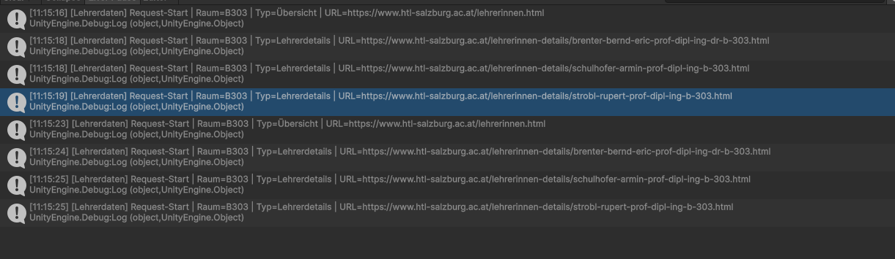

# Testprotokoll

## Issue 1: Stimmt die Sprechstunde?
- Tester: Moeez Awan
- Durchführung:
    - C312 betreten und die Sprechstunde von Richard Grutschnig mit der Schulwebsite verglichen.
- Erwartet:
    - Tag und Uhrzeit stimmen überein.
- Ergebnis:
    - In unserer Anzeige und auf der Website steht Montag, 09:45–10:35 Uhr. Passt.
## Issue 3: Wird die passende Detailseite geladen?
- Tester: Alichan Schajchiev
- Durchführung:
  - Eine Lehrkraft in einem vorhandenen Raum gewählt. URL und Antwortlänge nach dem erfolgreichen `GetStringAsync` in der Console geloggt und in einer frischen Sitzung geprüft.
- Erwartet:
  - Die erwartete URL erscheint mit einer Antwortlänge größer als null.
- Ergebnis:
  - In der Console wird die Detail-URL mit einer Antwortlänge größer als 0 ausgegeben. Passt.
  !Konsolenausgabe von Issue 3: (.img/protokoll_detailseite.png)

## Issue 4: Wird die Lehrkräfteübersicht geladen?
- Tester: Alichan Schajchiev
- Durchführung:
  - URL und Antwortlänge nach dem erfolgreichen `GetStringAsync` geloggt und in einer frischen Sitzung beim Betreten des Türbereichs für `lehrerinnen.html` geprüft.
- Erwartet:
  - Die erwartete URL erscheint mit einer Antwortlänge größer als null.
- Ergebnis:
  - In der Console wird `lehrerinnen.html` mit einer Antwortlänge größer als 0 ausgegeben. Passt.
!Konsolenausgabe von Issue 4: (.img/protokoll_Lehrerübersicht.png)
## Issue 6: Was passiert mit den Requests beim erneuten Besuch?
- Tester: 
- Durchführung:
    - B303 betreten, verlassen und erneut betreten. Dabei die Request-Start-Einträge in der Console geprüft.
- Erwartet:
    - Bei beiden Besuchen wird die Übersicht neu abgerufen.
- Ergebnis:
    - In der Console sind zwei Übersichtsabrufe für B303 zu sehen. Auch die Lehrerdetails werden beide Male neu geladen. Passt.

## Issue 7: Was passiert, wenn die Übersicht nicht erreichbar ist?
- Tester: 
- Durchführung:
    - Ohne Internet B303 betreten und gewartet, bis der Abruf fehlschlägt.
- Erwartet:
    - Im Fenster steht „Fehler beim Laden der Lehrer.“ und die Console zeigt den Fehler.
- Ergebnis:
    - Im Fenster steht „Verbindung zur Schulwebsite fehlgeschlagen“. Der Fehler wird also angezeigt, nur mit anderem Text. Die Console-Ausgabe ist im Screenshot nicht zu sehen.

