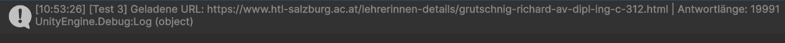
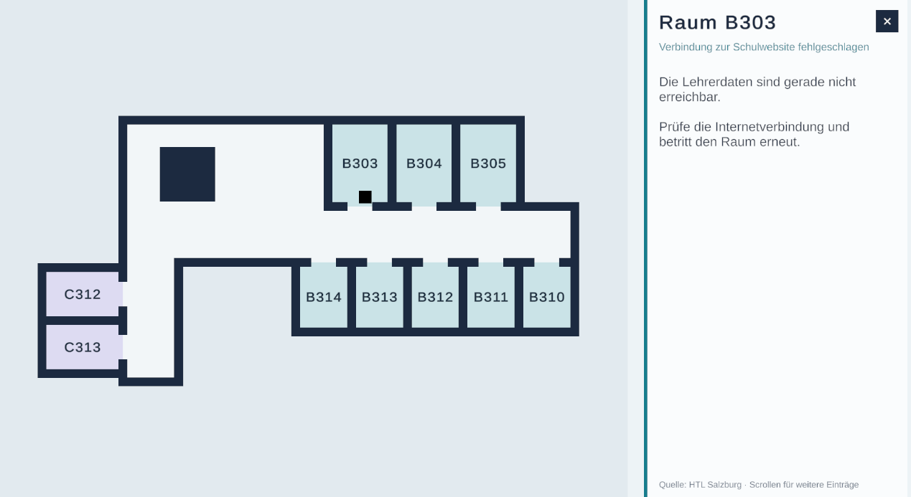

# Testprotokoll

**Testdatum:** 23.11.2026, 25.11.2026 **Getesteter Commit:** `b145d85`

Datum und Code-Stand sind anhand der Test-Commits im Repo zugeordnet. Tests 3 und 4 wurden am 24.11.2026 mit dem geänderten Code aus `d447f2e` durchgeführt; das steht auch in den jeweiligen Zeilen.

**Tester:** Moeez Awan (Tests 1, 6 und 7), Alichan Schajchiev (Tests 3 und 4), Burak Bilgic (Tests 2 und 5).

| Nr. | Durchführung | Soll | Ist | Status |
|---|---|---|---|---|
| 1 | Mit `b145d85`: C312 betreten und die Sprechstunde von Richard Grutschnig mit seiner Detailseite verglichen. | Tag und Uhrzeit stimmen überein. | Auf der Website und in unserer Anzeige steht Montag, 09:45–10:35 Uhr. | **Bestanden** |
| 2 | Zwei Räume (B312 und B303) im Play Mode geöffnet und mit der Schulwebsite abgeglichen. | Raumnummer und Personen stimmen für beide Räume. | Raumnummern und zugeordnete Lehrkräfte stimmen mit der Website überein. | **Bestanden** |
| 3 | Am 24.11.2026 mit `d447f2e`: In einer frischen Sitzung C312 betreten. Nach dem erfolgreichen `GetStringAsync` die URL und Antwortlänge für `/lehrerinnen-details/grutschnig-richard-av-dipl-ing-c-312.html` geloggt. | Die erwartete URL erscheint mit einer Antwortlänge größer als null. | Die passende Detail-URL wird mit `Antwortlänge: 19991` ausgegeben. | **Bestanden** |
| 4 | Am 24.11.2026 mit `d447f2e`: In einer frischen Sitzung den Türbereich betreten und nach dem erfolgreichen `GetStringAsync` URL und Antwortlänge für `https://www.htl-salzburg.ac.at/lehrerinnen.html` geloggt. | Die erwartete URL erscheint mit einer Antwortlänge größer als null. | Die Übersichts-URL wird mit `Antwortlänge: 100841` ausgegeben. | **Bestanden** |
| 5 | Raum B312 geöffnet und bei Grossmaier Maria-Rosa Durchwahl und E-Mail geprüft. | Die Angaben stimmen überein und stehen am vorgesehenen Platz. | Durchwahl (228) und E-Mail stimmen mit der Website überein und stehen am vorgesehenen Platz. | **Bestanden** |
| 6 | Mit `b145d85`: B303 betreten, verlassen und erneut betreten. Die Request-Starts direkt vor dem HTTP-Aufruf mit `Debug.Log` geloggt und in der Console geprüft. | Zwei Abrufstarts für denselben Raum. | Zwei Einträge mit `Raum=B303` und `Typ=Übersicht`, um 11:15:16 und 11:15:23. Auch die Detailseiten werden erneut abgerufen. | **Bestanden** |
| 7 | Mit `b145d85`: Ohne Internet B303 betreten und gewartet, bis der Abruf fehlschlägt. | Im Fenster steht „Fehler beim Laden der Lehrer.“ Die Console zeigt den Fehler. | Im Fenster steht „Verbindung zur Schulwebsite fehlgeschlagen“. Die Fehlermeldung wurde von uns trotz anderem Wortlaut als passend bewertet. Die Console-Ausgabe ist im Screenshot nicht zu sehen. | **Bestanden** |

## Bilder

### Test 3: Detailseite

### Test 4: Lehrkräfteübersicht

### Test 6: Erneuter Besuch

### Test 7: Ohne Verbindung

